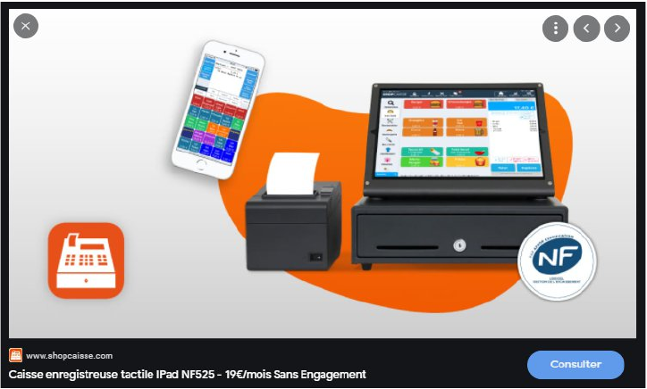
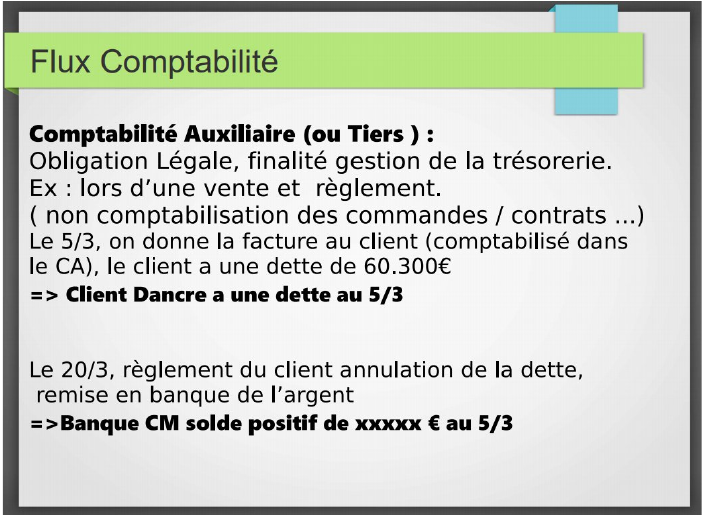

# Création d'ERP Gestion d'Associations d'étudiantes

| Objet  | ERP : TP réalisation de modules fonctionnels interconnectés |
| ------ | ----------------------------------------------------------- |
| Sujet  | Création d'ERP Gestion d'Associations d'étudiantes          |
| Auteur | G. Lacreuse                                                 |

## Introduction

Les ERP, Enterprise Ressource Planning, sont des logiciels de gestion du back office d'une organisation ou d'une entreprise, interconnectés aux systèmes d'informations internes et externes.

L'objectif de ce TP est de vous sensibiliser aux nombreux échanges d'informations qu'il peut y avoir entre différentes entités. Chaque entité est autonome dans sa fonction, mais elle a besoin de communiquer avec les autres afin de pouvoir être pleinement opérationnelle.

Pour votre TP, nous partirons d'un scénario fictif : des jeunes diplômés du CNAM (promo 2027) décident de se mettre tous ensemble pour développer et vendre un ERP de gestion d'association étudiante STUD'RP sous marque blanche, c'est-à-dire que l'ERP portera le nom de l'association.

Quel est le business model ? très simple, L'application cloud est 100% gratuite et se rémunère via une commission de 4,5% sur chaque transaction bancaire avec un hébergement annuel de 100€. Si les commissions sont supérieurs à 100€, l'hébergement n'est pas facturé.

La promo 2027 du CNAM se propose d'utiliser son application pour son association CNAMUS avant de la mettre en ligne en septembre 2027, voici quelques mots sur CNAMUS :

> « Une association chaleureuse, dynamique et investie ! CNAMUS un jour, CNAMUS toujours ! » mot du président
>
> Association crée en 1970, CNAMUS a pour mission principale d'aider les étudiants en informatique en leur proposant une multitude de services et d'événements au cours de l'année.
>
> L'association demande une cotisation annuelle d'adhésion de 11€, organise des ventes d'articles lors des pauses, ou lors de soirées qu'elle organise. Elle achète également ces articles et dispose d'un stock à l'école. Elle souhaite également suivre les anciens étudiants pour savoir les débouchés, salaires et disposer d'un réseau pour les apprentissages ou stages à l'étranger par ex. L'association tient un carnet de compte et dispose d'un compte en Banque. Au niveau des paiements, 2 possibilités, en ligne ou par carte bleue (solution mobile) qu'il s'agira d'interfacer, voici les références :
>
> - <https://sumup.fr/>
> - <https://developer.sumup.com/rest-api/>
>
> L'association tient à jour sa comptabilité et également la rentabilité des évènements ou soirées.
>
> « Les associations doivent, par nécessité démocratique et de bonne gestion, tenir une comptabilité. La loi du 1er juillet 1901 n'impose en la matière aucune obligation aux associations. Les statuts prévoient généralement que le trésorier rend compte de sa gestion et soumet les comptes à l'approbation de l'assemblée. Une telle obligation peut toutefois, résulter de dispositions, d'origine et de finalité diverses (statuts, agréments, mise en place d'activités commerciales...). »

Source :

- <https://www.associations.gouv.fr/la-comptabilite-associative.html>
- <https://www.associations.gouv.fr/association-en-alsace-moselle-quelles-sont-les-formalites-de-creation.html>

Informatiquement, il s'agit dans ce TP de proposer une solution logicielle avec 4 applications (ou modules), que vous développerez et que vous interconnecterez (API, REST, socket, …).

Le « **nom de l'association** » sera une clé structurante, et permettra de gérer potentiellement plusieurs associations. La notion d'évènement sera également un élément structurant pour lier les achat et ventes d'un événement.

## 1. Description du sujet

### 1.1. Contexte

Les associations ont des objectifs/problématiques métiers.

Pour l'association des étudiants en informatique nous avons recensé les besoins suivants :

#### APPLICATION STUD'

Cette application est destinée aux étudiants, ce sont eux les utilisateurs

##### 1.1.1 STUDENT : Gestion des étudiants

Constituer un réseau et l'animer dans le temps est l'objectif premier d'une association étudiante. Les fonctionnalités suivantes sont requises :

- Informations de contact, photo et identifiant unique
- Adhésion / cotisation annuelle paiement en ligne
- Gestion du solde/compte étudiant
- Accès par l'étudiant à son compte et historique des transactions.
- Gestion de la RGPD
- Module Al

L'application doit permettre de savoir si un contact est connu, adhérent, à jour de ses cotisations et de connaître le montant de son solde créditeur ou débiteur. A noter que les profs ou membres de l'école peuvent également adhérer à cette association.

En termes de logiciel on parle ici de « Solution de gestion des adhérents ou Customer Relationship Management CRM », appartenant aux applications dites Front Office.

##### 1.1.2 ALUMNI : Gestion des anciens étudiants

Les anciens étudiants continuent à adhérer et on la possibilité de renseigner leurs informations, pour faciliter par exemple les stages à l'étranger, l'apprentissage …

Un point important sera la possibilité de renseigner des infos sur la première embauche :

- temps de chômage,
- libellé du premier poste,
- type de contrat,
- nom de la société
- domaine d'activité,
- salaire brut (hors primes, km, tickets restaurants), primes, autres avantages.

=> Attention à l'anonymat

#### APPLICATION STUD'ASSOCIATION

Cette application est destinée au bureau des élèves , gérer les adhésions, les comptes de l'association, les stat.

##### 1.1.3 BACK : Stock, Comptabilité et statistiques

- Liste des Etudiants et adhésions
- Statistiques de la partie Alumni
- Bibliothèque de références / prix de vente ( ex : jus d'orange 1€, prix adhérent 0,50€ )
- Saisie des achats ( =entrée en stock) références / prix d'achat / date
- Possibilité d'ajustement de stock ( on ne supprime jamais d'écriture )
- Générer les automatiquement les écritures comptables comme préciser en annexe en fonction du type d'écriture « Achat, Règlement Fournisseur, Vente, Encaissement client. » fourni par les autres modules.
- Important : les adhésions constituent des ventes.
- Possibilité de saisie écriture comptable (on ne supprime jamais d'écriture)
- Calcul de rentabilité d'évènements

En termes de logiciel on parle ici de « Solution Comptabilité ou Accounting System » , appartenant aux applications dites Back Office.

##### 1.1.4 RMS : Application mobile de caisse enregistreuse

Cette application va permettre de gérer tous les paiements ou transactions des étudiants.

- Recherche dans la Bibliothèque de réf. / prix
    - ex : jus d'orange 1€, prix adhérent 0,50€
- Recherche étudiant / statut / solde
- Saisie des ventes par référence / date / **Evènement**
- Addition sur compte adhérent, monnaie ou carte bleue.
- Pas d'impression de facturette, les transactions seront visibles sur le compte client.

En termes de logiciel on parle ici de « Solution Caisse Enregistreuse ou Retail Management System RMS» , appartenant aux applications dites Front Office.

#### APPLICATION STUD'EDITEUR

Cette application est destinée à la société STUD'RP

##### 1.1.5 ADMINISTRATION STUD'RP

- paramétrage des associations étudiants et comptes administrateurs
- paramétrages bancaires des associations
- récapitulatif des écritures et commissions
- solution de ticketing : les associations peuvent créer des tickets de support en cas de soucis.

##### 1.1.6 MONEY Gestion des paiements

- Paiement en ligne
- Echange avec le Terminal de Paiement Electronique (TPE) par carte bleue
- Chaque transaction va générer 2 appels de paiement 95% sur le compte de l'association et 5% sur le compte de STUD'RP

La solution Sum'Up est proposé, une autre solution peut être utilisée sur proposition.

En termes de logiciel on parle ici de « Solution monétique ou Electronic Banking System EBS » , appartenant aux applications dites Front Office pour le paiement et Back Office pour la gestion.

### 1.2. Objectif

L'objectif de ce TP est de réaliser les 5 applications :

- **STUD** Student et Alumni,
- **STUD ASSOCIATION BACK**,
- **STUD ASSOCIATION RMS**,
- **STUD'RP** et
- **STUD'RP MONEY**.

Il faudra donc former 5 sous-groupes et affecter à chacun une application à réaliser. Chaque application doit être autonome (partage de base de données interdit !!!) et chacune peut utiliser des technologies différentes, adaptées au contexte. Par simplification on ne créera pas de vraie application mobile mais des sites web.

On ajoutera un 6ème équipe **architecture** du système d'information, en charge des échanges de données. eur rôle est prépondérant dans cette avanture.

A titre d'exemple, un étudiant qui achète un café au RMS, verra cette dépense sur l'application STUD Student, et l'association verra également cette dépense dans STUD ASSOCIATION BACK, Stud'RP retrouvera également cette dépense dans son application. Cette équipe aura la charge de prévoir une structure de données pour 2 associations CNAMUS et ADECAWEB.

On ajoutera une 7ème équipe en charge de **l'infrastructure**, hébergement et sécurité. Ils ont la charge de trouver un hébergement gratuit ou à faible cout, accessible sur le web. Leur rôle est capital dans cette épopée.

Comme indiqué plus haut, chaque application doit pouvoir fonctionner de manière autonome.

Une note collective sera attribuée pour le bon fonctionnement des applications interconnectées qui seront présentées lors du dernier TP .

Un bonus spécial, supplémentaire, sera appliquée si les applications sont en ligne, disponibles avec des données réelles.

## 2. Les attentes

### 2.1. Fonctionnelles

Chacun des modules devra pouvoir fonctionner de manière indépendante mais aussi en mode intégré. C'est-à-dire que les modules devront pouvoir communiquer entre eux. Idéalement sans intervention manuelle.

### 2.2. Technologiques

Vous êtes libre dans les choix :

- Du langage de programmation,
- De la réalisation de l'interface,
- Du mode de transfert et de stockage des données entre les modules,
- …

L'application RMS doit fonctionner de façon optimisée sur téléphone mobile, et les autres applications sur mobile/desktop.

L'application **STUD'RP MONEY** n'a pas forcément besoin de front. Les groupes 6 et 7 vont eux gérer des logs, scripts de déploiement, outils de monitoring, mais pas de front a proprement dit.

Vous trouverez en annexe un exemple de structuration des données.

## 3. Les délivrables

Nous vous demanderons à l'issue du TP de nous fournir les documents suivants :

- Un code clair et commenté,
- Un fichier exécutable,
- Les spécifications techniques pour les interfaces,
- Un fichier des données transmises,
- Un fichier des données reçues,
- Un document expliquant la stratégie d'échange de données, réalisé par l'équipe 6
- Un document expliquant l'infrastructure, la sécurité, réalisé par l'équipe 7
- Faire une conclusion globale sur l'ensemble des modules interconnectés.

## 4. Planning/Notation

### 4.1. Planning du TP

Temps prévu : 8h en TP + 15 min par groupe de présentation des travaux (pas de support de présentation)

### 4.2. Notation

| Note  | Critères                                                                 |
| ----- | ------------------------------------------------------------------------ |
| 7 pts | Fonctionnement unitaire des modules                                      |
| 6 pts | Fonctionnement de l'ensemble des modules ( pour toute la promo )         |
| 2 pts | qualité de la réalisation et des livrables ( documentation, conclusion ) |
| 5 pts | Présentation de la réalisation                                           |

## 5. Annexes

source : _Guillaume LACREUSE - ERP et Processus Métiers / CNAM_

|              | Date     | Ecritures :       | Débit | Crédit | C                                    |
| ------------ | -------- | ----------------- | ----- | ------ | ------------------------------------ |
|              | 1-janv.  | 101 Capital       |       | 500€   |                                      |
|              | 1-janv.  | 512 Banque        | 500€  |        |                                      |
| Achat        | 2-févr.  | 601 Achat         | 152 € |        | Facture d'Achat                      |
| Achat        | 2-févr.  | 401 Fournisseur   |       | 152 €  | Facture Achat = dette au fournisseur |
| Règlement    | 2-févr.  | 401 Fournisseur   | 152 € |        | Règlement de la facture d'achat      |
| Règlement    | 2-févr.  | 512 Banque        |       | 152€   | Règlement de la facture d'achat      |
| Vente        | 15-févr. | 706 Vente         |       | 60€    | Vente                                |
| Vente        | 15-févr. | 445 TVA Collectée |       | 12 €   |                                      |
| Vente        | 15-févr. | 411 Client        | 72 €  |        | Facture vente = Dette client         |
| Encaissement | 15-févr. | 411 Client        |       | 72 €   | Encaissement de l'argent             |
| Encaissement | 15-févr. | 512 Banque        | 72 €  |        | = La dette du client est soldée      |
